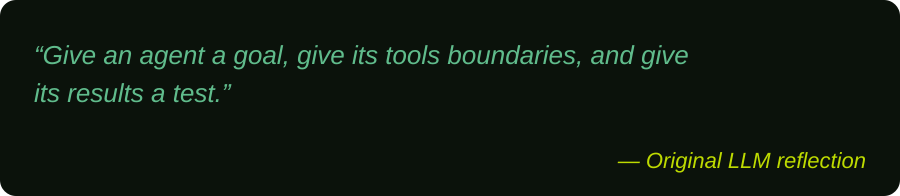

# 👋 Hi there, I'm Junaed Ahmed

**Aspiring LLM Researcher · Agentic AI Expert**

- 🔬 Exploring language models, AI agents, and reliable intelligent systems.
- 🤝 Open to **agentic AI roles, AI/ML internships, freelance projects, and research collaboration**.
- 🌱 Deepening my understanding of transformers, retrieval-augmented generation, and agent evaluation.

## 🧑‍💻 About Me

I'm **Junaed Ahmed**,  My long-term goal is to become an **LLM researcher**, studying how language models learn, represent knowledge, and support useful reasoning.

I want to connect research with practical engineering by building **AI agents and LLM applications** that use tools, work with relevant context, and produce results that can be evaluated. I'm particularly interested in reliability, data privacy, prompt injection, and secure agent workflows. Currently Researching Language Model Architecture & Asynchronous Training.

My broader interests include computer vision, human–computer interaction, and blockchain. Alongside AI, I use data analysis and backend development to turn ideas into practical, reproducible projects.

## 🌐 Socials

## 💻 Tech Stack

## 🔬 Research Interests

- **LLM architecture & NLP:** transformers, attention, deep learning, training, and fine-tuning.
- **Agentic AI:** tool use, planning, memory, retrieval, and multi-step workflows.
- **Evaluation & security:** reliable outputs, privacy, prompt injection, and data leakage.

## 🚀 Projects

[Explore my public projects](PUBLIC-PROJECTS.md) · [Visit my portfolio](https://junaed-ahmed.vercel.app)

## ✍️ Random LLM Quote

<!-- LLM_QUOTE_START -->

<!-- LLM_QUOTE_END -->

## 📊 GitHub Stats

  
  

